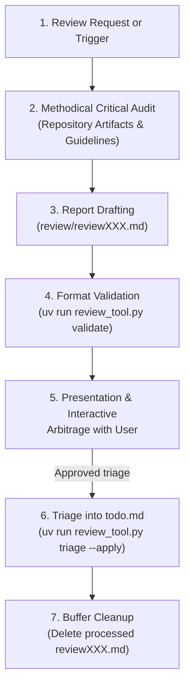

# Skill: Review (Technical Audit & Review Processing)

This skill provides a **domain-agnostic methodological and CLI framework** for initializing, conducting, validating, and triaging technical reviews across any software, firmware, or hardware repository.

Domain-specific rules, audit axes, and known constraints live in each project's own `review/guidelines.md` (never hardcoded in the skill).

---

## 0. Auditor Posture: Tabula Rasa & Exclusive Physical Evidence

> [!IMPORTANT]
> **Golden Rule of the Audit: Memory Erasure & Absolute Impartiality**
> Throughout the technical review, the reviewer agent **must disregard all prior conversational memory or preconceived project knowledge**. It must adopt the strict, impartial posture of an independent third-party auditor discovering the repository for the very first time.

1. **No reliance on memories or assumptions:**
   Any technical decision not formalized in versioned repository files is considered non-existent.
2. **Analysis based exclusively on repository artifacts (*Evidence-Based*):**
   Every finding must be grounded in directly observable and verifiable evidence within the repository (source code, configuration files, tests, build logs, datasheets, schematics, and `todo.md`).
3. **Mandatory critical confrontation:**
   Internal documentation or prior task items in `todo.md` must never be taken at face value. Cross-check claims against actual implementation, authoritative specs, and project guidelines.

---

## 1. Skill Directory Tree

```text
.agents/skills/review/
├── SKILL.md                          # Domain-agnostic methodology and CLI guide
├── scripts/
│   └── review_tool.py                # Agnostic CLI engine: init, generate, validate, triage
└── templates/
    └── guidelines_base.md            # Domain-agnostic English base guidelines template
```

> [!NOTE]
> **Single Source of Truth (SSOT):** The standardized review template is not duplicated. It is dynamically extracted by `review_tool.py generate` directly from Section 5 of `review/guidelines.md`.

---

## 2. CLI Tool Usage (`scripts/review_tool.py`)

> [!IMPORTANT]
> Execute scripts via `uv run`.

### 0. Initialize a Project Review Directory
Creates `review/` and generates a 100% English domain-agnostic `guidelines.md` draft from `templates/guidelines_base.md`:
```bash
uv run .agents/skills/review/scripts/review_tool.py init --project "My Project"
```
Optional flags: `--dir <path>` (default: `review`), `--force` (overwrite existing `guidelines.md`).

### A. Generate a Standardized Blank Review Skeleton
Extracts the template from Section 5 of `review/guidelines.md` and creates the next available review file (e.g., `review/review001.md`):
```bash
uv run .agents/skills/review/scripts/review_tool.py generate
```
To specify a custom path or guidelines file:
```bash
uv run .agents/skills/review/scripts/review_tool.py generate -o review/review_audit.md --guidelines review/guidelines.md
```

### B. Validate Review Report Compliance
Verifies mandatory metadata fields, executive summary presence, and strict formatting for each observation:
```bash
uv run .agents/skills/review/scripts/review_tool.py validate review/review001.md
```
For automated agent integration (JSON output):
```bash
uv run .agents/skills/review/scripts/review_tool.py validate review/review001.md --json
```

### C. Triage a Review into `todo.md`
Displays formatted action items categorized by severity (`🔴 Blocking`, `🟠 Important`, `🟢 Minor`) and detects collisions with existing entries in `todo.md`:
```bash
uv run .agents/skills/review/scripts/review_tool.py triage review/review001.md --todo-file todo.md
```
Following explicit user approval, inject tasks under the targeted section and optionally delete the processed review file:
```bash
uv run .agents/skills/review/scripts/review_tool.py triage review/review001.md --todo-file todo.md --section "## Phase 1" --apply --delete-review
```

---

## 3. Review Lifecycle


